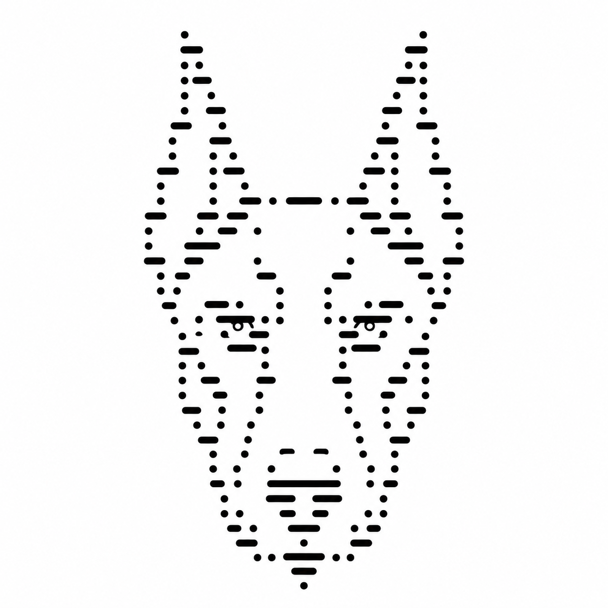

<p align="center"></p>

# doberman-agent

Plataforma Agent empresarial de código abierto para crear, desplegar y gestionar aplicaciones de IA, con tareas de varios pasos, flujos de trabajo, recuperación de conocimiento, integración de modelos y control de acceso para equipos.

[简体中文](README.md) · [English](README_EN.md) · [日本語](README_JPN.md) · [Español](README_ES.md) · [Português](README_PT.md) · [Русский](README_RU.md)

## Funciones

- Agentes que combinan herramientas, habilidades y archivos, con intervención humana y generación de documentos.
- Flujos visuales para conversaciones, automatización, bucles, ejecución paralela y procesamiento por lotes.
- Espacios de conocimiento con RAG, citas de fuentes y permisos por archivo.
- Configuración de modelos y herramientas API/MCP, gestión de organizaciones, múltiples inquilinos y registros de auditoría.
- Compilación, aprobación, publicación y gestión de aplicaciones alojadas; requieren configurar el entorno de ejecución opcional.

## Primeros pasos

Instala e inicia Docker y prepara Docker Compose V2, Git y Bash. Las dependencias de compilación y los registros de imágenes configurados deben ser accesibles.

```bash
git clone https://github.com/cp7553479/doberman-agent.git
cd doberman-agent
bash docker/install.sh --prepare-only
```

Antes de iniciar, sustituye las credenciales de desarrollo y configura:

- `docker/.env`, generado desde [`docker/.env.example`](docker/.env.example): imágenes de infraestructura, autenticación del registro, credenciales de MinIO y token del sandbox.
- [`docker/docker-compose.yml`](docker/docker-compose.yml): contraseña de MySQL y cadenas de conexión de ambos servicios OpenFGA.
- [`docker/doberman-agent/config/config.yaml`](docker/doberman-agent/config/config.yaml): conexiones del backend. La contraseña de `database_url` debe usar el formato cifrado nativo y coincidir con MySQL.

```bash
bash docker/install.sh
cd docker
docker compose ps
docker compose logs -f backend backend_worker
```

El instalador compila las imágenes de la aplicación desde este código, descarga las imágenes de infraestructura e inicia los servicios. Cuando estén listos, abre `http://SERVER_IP:3001`. El primer usuario registrado será administrador; configura los modelos después de iniciar sesión. El análisis externo de documentos y los entornos opcionales necesitan configuración adicional. Consulta el [despliegue con Docker](docker/README.md).

## Documentación y contribuciones

[Documentación](docs/README.md) · [Arquitectura](docs/architecture/01-architecture-overview.md) · [SDK de Python](src/doberman-agent-sdk/README.md) · [CLI](src/doberman-agent-cli/README.md)

Puedes contribuir mediante [pull requests](https://github.com/cp7553479/doberman-agent/pulls). Sigue el [Código de conducta](CODE_OF_CONDUCT.md).

Licencia [Apache 2.0](LICENSE). Consulta los [agradecimientos](README.md#致谢).
